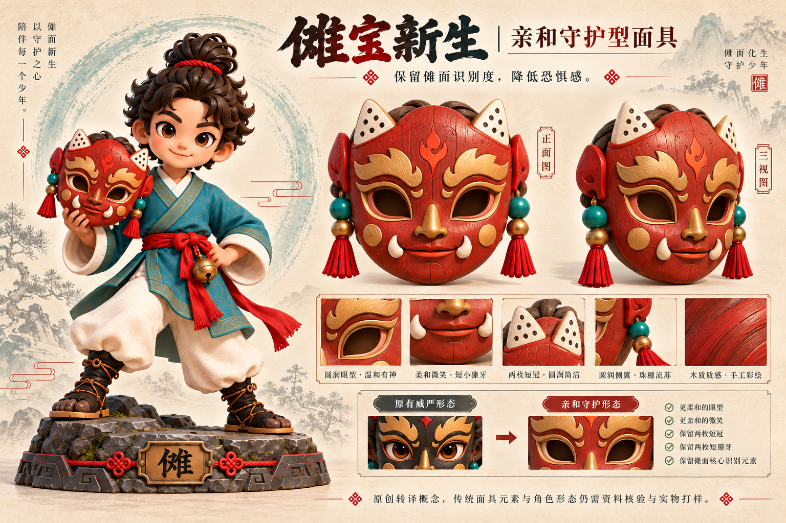
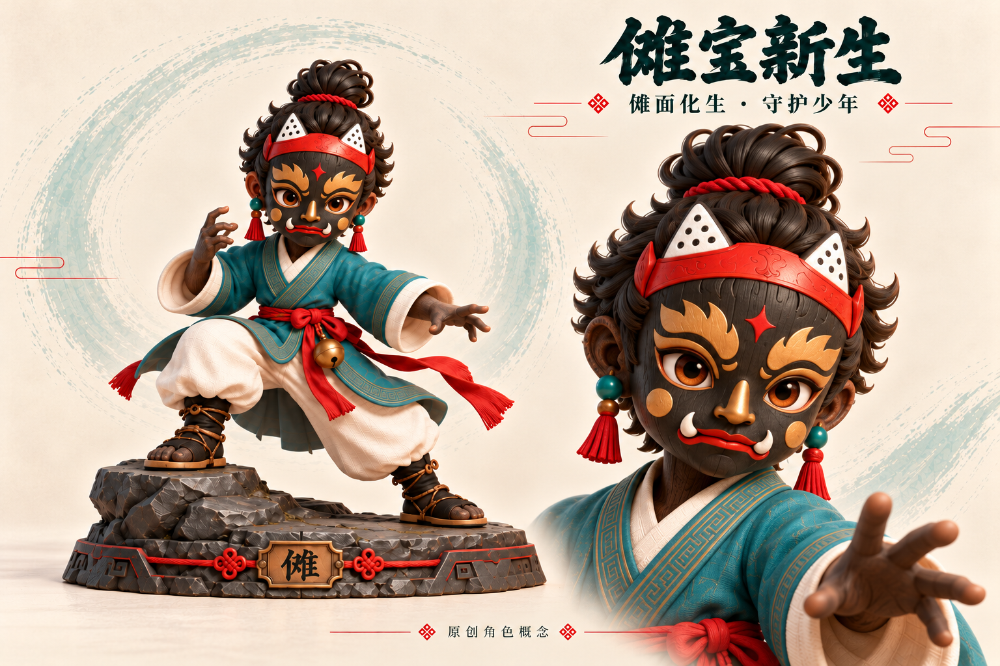
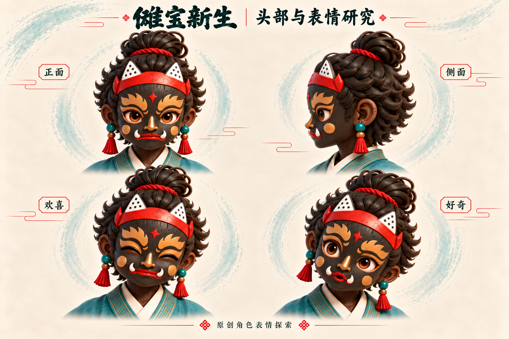
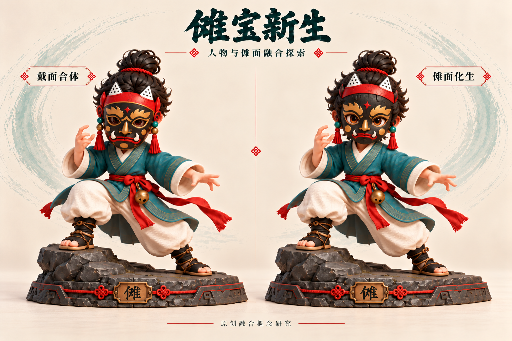

# 傩宝新生：当前效果审阅图

本页展示已生成的效果审阅图，尚非正式参赛文件。

## 亲和守护型面具（最新探索）

针对面具过于凶猛的问题，降低黑色面积与尖锐獠牙，改用暖朱红木色、圆润眼孔、柔和眉形和微笑嘴型，保留傩面核心色彩与双尖冠。

[打开亲和守护型面具原图](nuobao-friendly-mask.png)

## 最新深化：傩面化生·守护少年

沿融合对比图右侧方案深化，面部、耳朵、颈部和手脚采用连贯的木雕质感。金色眉形、鼻形、双牙与红色冠部成为角色自身的造型特征。

### 主视觉与头部特写

[打开主视觉原图](nuobao-fusion-hero.png)

### 头部与表情研究

正面、侧面、欢喜和好奇，用于观察角色结构与表情变化。

[打开头部与表情原图](nuobao-fusion-expressions.png)

以下为此前的方案探索与包装概念；包装中的角色尚未随最新造型更新。

## 人物与傩面融合探索（10月21日新增）

左侧为完整戴面，右侧将傩面五官融入角色自身的长相。两者是原创方案对比。

[打开融合对比原图](nuobao-fusion-comparison.png)

## 双状态摆件效果

[打开摆件原图](nuobao-display.png)

## 包装与故事卡效果

[打开包装原图](nuobao-packaging.png)

图片按生成结果原样展示。人物、面具与力量来源属于原创设计设定；连接结构、稳定性及包装配合尚待实物打样验证。
